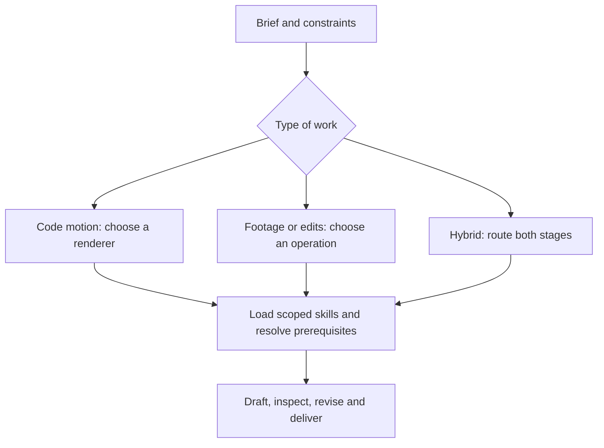

# Awesome Video Skills

**Choose a video workflow, load the right skills, and check the result.**

An agent-navigable catalog for generated footage, code-authored motion graphics, editing and finishing. Start with the task, narrow to a model version and provider, then load a compatible skill and its execution checklist.

<!-- avs:stats:start -->
**206 pinned upstream skill paths · 47 repositories · 31 model/backend/workflow surfaces · 24 workflows · 12 original installable skills**

Catalog update: **2026-10-12**. Preferred model-release window: **2026-04-12–2026-10-12**. Each record retains its own evidence date; an update does not re-certify older entries.
<!-- avs:stats:end -->

This is source-backed curation with an offline router. Model quality, account access and upstream runtimes need their own checks.

[Decision flow](docs/decision-flow.md) · [Model index](docs/model-index.md) · [Skill catalog](docs/catalog.md) · [Motion graphics](docs/motion.md) · [Research coverage](research/coverage.md)

## Choose by the result you need

| You want to make | Start with | Why this route |
| --- | --- | --- |
| An app launch, exact UI demo or animated chart | [Remotion / HyperFrames](docs/motion.md) | Keep copy, layout, timing and brand assets editable. |
| Cinematic footage from a prompt or image | [Model index](docs/model-index.md) | Match the exact operation, reference inputs and provider limits. |
| An edit to an existing shot | [Runway Aleph 2.0](docs/models/runway.md) or [LTX](docs/models/ltx.md) | Preserve a source-driven editing workflow; distinguish outpainting from temporal extension. |
| A presenter or translated recording | [HeyGen workflows](docs/workflow-recipes.md#presenters-and-translation) | Separate identity setup, presenter generation, dubbing and subtitles. |
| A researched explainer or narrated motion piece | [Workflow recipes](docs/workflow-recipes.md) | Combine source review, timed narration, visual composition and finishing. |
| A better result from an existing skill | [Evaluation protocol](docs/evaluation.md) | Compare the production process and finished video, record failures, and retest a focused revision. |

See the [October 12 research update](research/2026-10-12-update.md) for the new entries, corrections and deliberately deferred candidates.

## For agents: start here

Read [AGENTS.md](AGENTS.md) or install [video-router](skills/video-router/SKILL.md). The router works offline with Python 3.10+ and no dependencies. It returns a plan, compatible candidates, excluded candidates with reasons, and the next document to read. It does not install third-party code or spend generation credits.

```bash
git clone https://github.com/Amal-David/awesome-video-skills.git
cd awesome-video-skills

# Astra is the controller; Remotion is the renderer.
python3 scripts/avs.py route --task motion --agent astra --engine remotion

# Choose a model and its actual provider surface.
python3 scripts/avs.py route --task reference --model h3-max --provider fal --audio-only

# Search instructions without loading the whole catalog.
python3 scripts/avs.py search 'kinetic typography' --kind skills --limit 5
```

## The hierarchy



Opus and Astra write or orchestrate the work; they are not video endpoints. A provider adapter is not the underlying model. Native generated sound is not input-audio conditioning. Motion transfer is not motion graphics. Those distinctions are encoded in the registry, not left to a long README footnote.

| Model family | What the guide helps distinguish |
| --- | --- |
| [MiniMax H3 / H3 Max / Turbo](docs/models/minimax.md) | Local FL2VA vs Ref2VA checkpoints; fal vs ChatCut support; portable prompting vs Hub-only workflows. |
| [Seedance 2.5](docs/models/seedance.md) | Longer stories, mixed references, audio conditioning, edits and continuation; BytePlus, Scenario and ChatCut contracts. |
| [LTX 2.5 / 2.3](docs/models/ltx.md) | Fast vs Pro output profiles, local multishot/LoRA work, and older retake/extension fallbacks. |
| [Gemini Omni 1.1 Flash](docs/models/gemini-omni.md) | Stateful edits, continuation handles, frame interpolation and draft/upscale stages. |
| [FLUX.3 Video](docs/models/flux.md) | Keyframes, continuation and enhancing a selected draft rather than resampling. |
| [Wan 3.0 / Prime](docs/models/wan.md) | Document/web context, multimodal creation and separate editing/local workflows. |
| [HappyHorse](docs/models/happyhorse.md) | 1.1 creation endpoints vs the separately versioned 1.0 edit surface. |
| [Kling 3.0](docs/models/kling.md) | Storyboard modes, tier distinctions and an older explicit-request fallback. |
| [Runway Gen-4.5 / Aleph 2.0](docs/models/runway.md) | First-frame creation vs source-video editing; timed keyframes, integer durations, canvas expansion and professional output restrictions. |

For code motion, choose among **Remotion, Hyperframes, Canvas/SVG/FFmpeg, Manim and Blender**. The curated upstream catalog includes maintainer-authored Remotion/Hyperframes skills, `brag`/`brag-slim`, iart’s specialized packs, and focused typography, chart, audio, launch-film and quality-review workflows. See the [motion guide](docs/motion.md) before selecting a renderer.

## Install only what you need

The installer copies **this repository’s original skills**, not every third-party skill in the catalog. It previews by default and never overwrites an existing installation.

```bash
# Preview, then install the complete self-contained router for Claude Code.
python3 scripts/install.py --skill video-router --target .claude/skills
python3 scripts/install.py --skill video-router --target .claude/skills --apply

# Or install into a Codex project’s skill directory.
python3 scripts/install.py --skill video-router --target .agents/skills --apply

# Or take just one model-specific playbook.
python3 scripts/install.py --skill video-ltx --target .claude/skills --apply
```

Available original skills: `video-router`, `video-motion`, `video-quality-review`, `video-minimax`, `video-seedance`, `video-ltx`, `video-gemini-omni`, `video-flux`, `video-wan`, `video-happyhorse`, `video-kling`, and `video-runway`.

The installed router includes its own catalog, guides and CLI. Use the actual installed skill directory when invoking its script. For another project, pass that project’s skill directory as `--target`. Host auto-loading follows the host’s own rules; `llms.txt` alone does not guarantee discovery.

## How an agent makes a decision

```bash
# A valid no-match result: do not silently substitute an older LTX model.
python3 scripts/avs.py route --task retake --model ltx-2-5

# A complete structured brief is more reliable than keyword inference.
python3 scripts/avs.py route --request examples/astra-motion.json
```


The first request above deliberately returns `no_compatible_route`. A supported selection returns `preflight_required`, never an instruction to skip account, schema, license or cost checks. Other examples cover an [Opus launch film](examples/opus-launch.json), [mixed H3 references](examples/h3-max-reference.json), [20-second LTX generation](examples/ltx-20-second.json), [Scenario](examples/scenario-seedance.json) and a [hybrid launch](examples/hybrid-launch.json).

## What is inside

| Area | Purpose |
| --- | --- |
| `skills/` | Original, installable router/model/motion/review skills, each with scoped references. |
| `registry/` | Source-backed capabilities, versions, providers, skills, workflow graph and retrieval chunks. |
| `docs/` | Model playbooks, upstream skill cards, architecture and retrieval instructions. |
| `scripts/` | Offline router, builder, safe local installer and optional read-only source audits. |
| `tests/` | Routing constraints, provider boundaries, packaging and generated-file checks. |
| `research/` | Discovery trail, primary sources, access limitations and immutable pin verification. |

Recent-model preference is not a blanket newest-model recommendation. LTX 2.5 Fast and Pro have different joint duration/fps/resolution profiles; a provider adapter can expose fewer modes than the underlying model. Specialized EXR/HDR, inpainting, outpainting, restoration, dialogue replacement and Foley routes are version-bound. [Read the architecture](docs/architecture.md).

## Validation and maintenance

```bash
python3 scripts/avs.py validate
python3 scripts/build.py --check
python3 -m unittest discover -s tests -v
# Optional network checks; gh must already be configured.
python3 scripts/verify_pins.py
python3 scripts/check_sources.py --limit 100
```

The source audit also has a manual GitHub Actions workflow. It reports drift for review; it does not auto-merge new claims, call paid generation endpoints or run scheduled polling. See [CONTRIBUTING.md](CONTRIBUTING.md).

## Research limits

GitHub and primary model/provider documents anchor the approved records. Hacker News, X/Twitter, Reddit and skill directories supplied discovery leads, with access gaps recorded in the [coverage report](research/coverage.md). Direct Reddit/X access was incomplete; secondary-only leads are labeled. This is broad curation, not a claim that every social post or every upstream runtime was inspected.

The [pin-verification report](research/pin-verification.json) records checks against immutable commits. That is source integrity, not runtime or security certification. Model endpoints, upstream installations and rendered-video quality have not been benchmarked by this project. Third-party skill bodies and model weights are linked, not bundled. [Security](SECURITY.md) · [Attribution and licensing](NOTICE.md).
